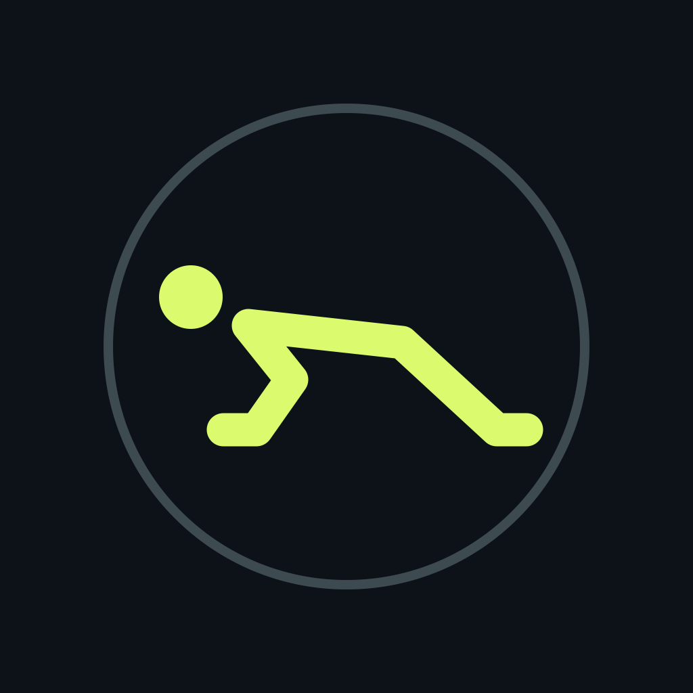

<p align="center">
  
</p>

<h1 align="center">Pushup Tracker</h1>

<p align="center">Compte tes pompes en direct et suis tes progrès jour après jour.</p>
<p align="center"><strong>iPhone · iOS 17+ · Swift 6 · SwiftUI</strong></p>

## Une séance en trois étapes

1. Dans **Aujourd’hui**, touche **Démarrer une séance**.
2. En mode **De face**, pose l’iPhone debout près du sol, face à toi. Garde au moins une épaule, un coude et un poignet dans le cadre. Touche **Lancer le compteur** et place-toi bras tendus pendant le décompte. Les lignes vertes suivent les bras visibles et les lignes bleues suivent les jambes visibles.
3. Touche **Terminer et enregistrer**. Les boutons **+** et **−** permettent de corriger le total de la séance ou de le saisir à la main.

| Écran | Ce que tu peux y faire |
| --- | --- |
| **Aujourd’hui** | Voir ton objectif de pompes, le total du jour et celui d’hier. |
| **Progression** | Comparer tes totaux quotidiens sur 7 ou 30 jours et retrouver ton record journalier. |
| **Réglages** | Modifier l’objectif et la durée maximale (de 1 à 30 min), puis activer un rappel quotidien à l’heure de ton choix. |

Le premier objectif est de **10 pompes** avec une limite de **10 minutes par séance**. À la fin du minuteur, la séance s’enregistre automatiquement. Pour recevoir le rappel, active-le dans **Réglages**, enregistre et autorise les notifications iOS. L’heure proposée est **18 h**.

## Installer sur ton iPhone

1. Clone ce dépôt ou télécharge le code, puis ouvre **Pushup Tracker.xcodeproj** dans Xcode 16 ou une version ultérieure.
2. Connecte et déverrouille ton iPhone. Dans **Signing & Capabilities** de la cible `PushupTracker`, sélectionne ton équipe de développement et laisse **Automatically manage signing** activé. Si Xcode signale que l’identifiant de l’app est déjà pris, attribue ton propre identifiant à la cible.
3. Sélectionne ton iPhone dans la barre d’outils et lance **Run** (⌘R). Active le mode développeur sur l’iPhone si Xcode le demande. [Guide Apple](https://developer.apple.com/documentation/xcode/enabling-developer-mode-on-a-device)

Le projet Xcode est inclus. XcodeGen sert uniquement si tu veux le régénérer à partir de `project.yml`.

## Comptage et confidentialité

AVFoundation fournit le flux de la caméra avant. [Apple Vision](https://developer.apple.com/documentation/vision/body-landmarks) repère les articulations. De face, chaque bras est suivi séparément et la répétition est comptée quand un même bras se plie puis se retend. La distance apparente entre le poignet et l’épaule aide quand le coude se plie dans l’axe de la caméra. Le visage et les jambes sont facultatifs. Le mode **De profil** utilise aussi l’angle du coude.

L’analyse se fait sur l’iPhone. Les images ne sont ni enregistrées ni envoyées. Seuls les totaux et les dates des séances sont conservés dans le stockage de l’app, avec les réglages. L’app fonctionne sans compte, serveur ni dépendance tierce.

## Lancer les tests

Lance **Product → Test** (⌘U) dans Xcode avec un simulateur iPhone, ou utilise la commande suivante avec le nom d’un simulateur installé.

```sh
xcodebuild test -project 'Pushup Tracker.xcodeproj' -scheme PushupTracker \
  -destination 'platform=iOS Simulator,name=iPhone 15 Pro'
```

Les tests couvrent les répétitions complètes et partielles, la perte de suivi, les angles du bras, le suivi de face, l’alignement de la superposition et le regroupement des séances par jour. Le simulateur permet de vérifier la saisie manuelle. Pour essayer le comptage vidéo, utilise un iPhone.
